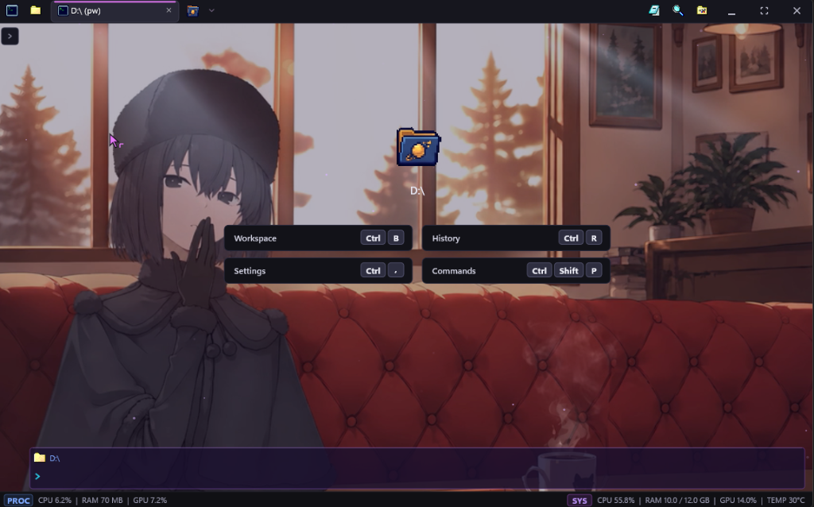
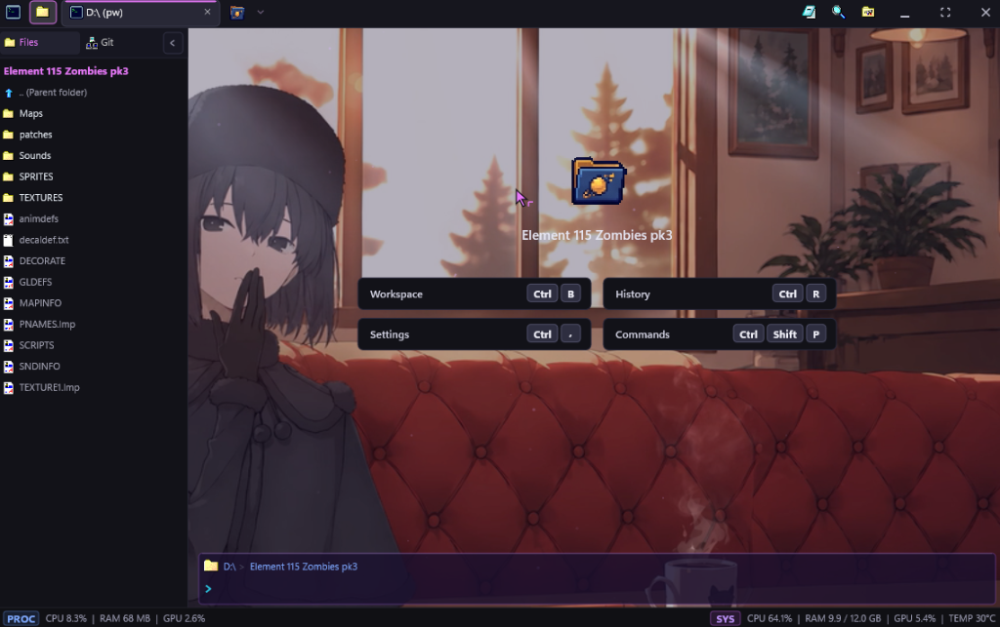
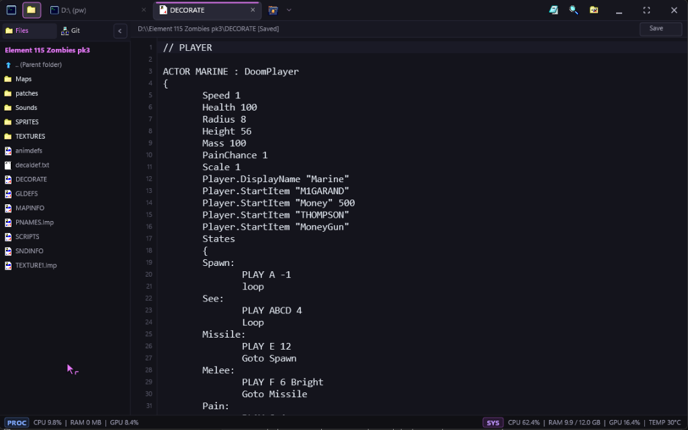
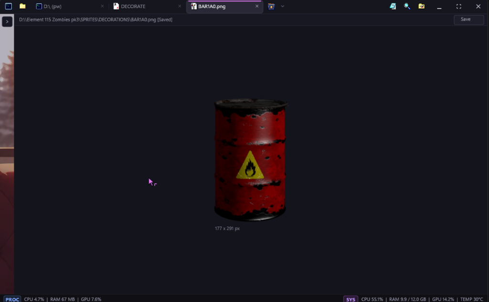
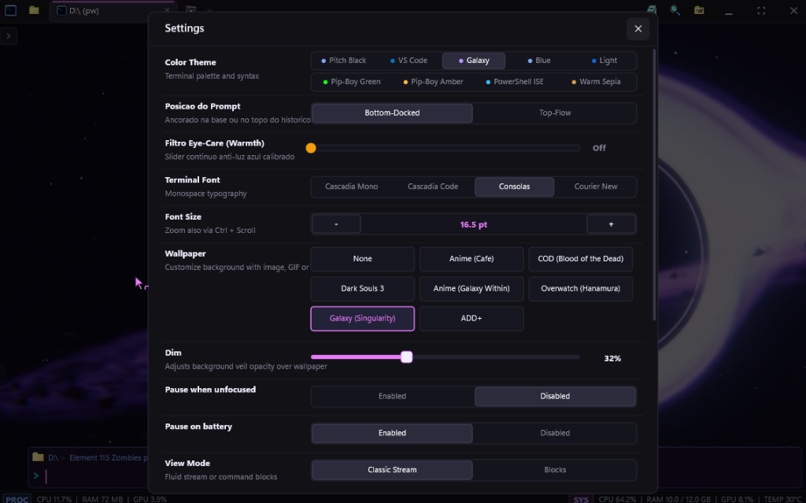

# Spet@term

Spet@term is a native Windows terminal emulator and micro-IDE written in C++20. It couples Direct2D hardware-accelerated rendering with Windows Pseudo Console (ConPTY) subsystem integration, delivering low resource usage and built-in developer tooling in a single standalone binary.



## Overview

Spet@term targets Windows 10 (1809+) and Windows 11 systems. It eliminates dependencies on web runtimes, Node.js, and third-party UI frameworks by building directly against Win32, Direct2D 1.1, DirectWrite, Direct3D 11, and DirectComposition APIs.

The executable compiles down to ~1.6 MB, requires 0 external runtime DLLs, and operates with an idle working set of ~3.6 MB.

## Interface Tour

### Workspace Explorer
A collapsible sidebar providing nested filesystem navigation, Win98 icon styling, and fast file access alongside the active terminal stream.



### Built-in Code Editor
A lightweight editor tab designed for rapid file inspection and configuration changes. Features line numbering, syntax highlighting, and unsaved state tracking without requiring an external editor.



### Asset and Image Viewer
Inline media previewer supporting PNG, JPEG, BMP, and ICO formats. Displays pixel dimensions, transparency checkerboard backing, and centered scaling for game development and asset workflows.



### Settings and Wallpaper Controls
In-app settings modal with live theme previews, eye-care warmth adjustment, prompt position docking (bottom or inline), typography controls, and video wallpaper settings.



## Core Capabilities

- **ConPTY Engine and Alternate Screen Buffer:** Full support for Windows Pseudo Console API. Handles VT100 / xterm sequences, color palettes, and alternate screen buffer switching for interactive console programs such as `diskpart`, `python`, `claude`, and `vim`.
- **Direct2D / DirectWrite Render Pipeline:** Hardware-accelerated text and glyph layout utilizing DirectComposition. Text rendering operates with sub-millisecond execution times and subpixel ClearType anti-aliasing.
- **Hardware-Decoded Video Wallpapers:** Background playback for MP4 video loops, animated GIFs, and static images via Windows Media Foundation (`IMFSourceReader`) with DXVA hardware acceleration sharing the Direct3D 11 device. Playback pauses automatically when the application is minimized or unfocused to prevent CPU and GPU drain.
- **In-Process Git Engine:** Inspects `.git/HEAD`, `.git/refs`, and `.git/index` directly in-memory, avoiding subprocess spawning overhead on every prompt cycle.
- **Smart Error Doctor:** Pattern-matching diagnostics engine for Clang, GCC, MSVC, Python tracebacks, and Git merge conflicts with quick-fix keyboard triggers.
- **Non-Client Frameless Window:** Custom `WM_NCCALCSIZE` and `WM_NCHITTEST` implementation preserving native DWM drop shadows, resize margins, and Windows 11 snap layouts.
- **Quake Dropdown Mode:** Global hotkey (`F12` or `Alt+\``) dropdown terminal with smooth slide animation.

## Technical Specifications

| Property | Specification |
| :--- | :--- |
| **Language** | C++20 |
| **Compiler** | Clang / LLVM 17+ with Microsoft C++ STL |
| **Target Platform** | Windows 10 (1809+) / Windows 11 (x64) |
| **Executable Size** | ~1.6 MB (standalone) |
| **External DLLs** | 0 (links strictly standard Windows system libraries) |
| **Graphics API** | Direct2D 1.1, DirectWrite, Direct3D 11, DirectComposition |
| **Media Engine** | Media Foundation (IMFSourceReader, DXVA), WIC |
| **Terminal Host** | Windows Pseudo Console (ConPTY) |
| **Memory Footprint** | ~3.6 MB idle working set |

## Keyboard Shortcuts

| Shortcut | Action |
| :--- | :--- |
| `Ctrl+T` | Open new terminal tab |
| `Ctrl+Shift+T` | Open new PowerShell tab |
| `Ctrl+W` / `Ctrl+F4` | Close active tab |
| `Ctrl+Tab` / `Ctrl+Shift+Tab` | Cycle to next / previous tab |
| `Ctrl+1` ... `Ctrl+9` | Switch directly to tab 1 through 9 |
| `Ctrl+B` | Toggle workspace file explorer sidebar |
| `Ctrl+Shift+P` | Open command palette |
| `Ctrl+R` | Open interactive timeline history search |
| `Ctrl+F` | Open in-terminal text search |
| `Ctrl+,` | Open settings modal |
| `Ctrl+Plus` / `Ctrl+Minus` | Increase / decrease font size |
| `Ctrl+0` | Reset font size to default |
| `Alt+P` | Toggle prompt position (docked bottom vs inline) |
| `Alt+B` | Run primary contextual project task |
| `Alt+Shift+P` | Pin / unpin last command block |
| `F1` | Open keyboard shortcuts and reference modal |
| `F11` | Toggle fullscreen mode |
| `F12` / `Alt+\`` | Toggle Quake dropdown console (global hotkey) |

## Source Tree Structure

```
src/
├── main.cpp                  # Win32 message pump, window lifecycle, input dispatch
├── renderer_d2d.hpp          # Direct2D, DirectWrite, and DirectComposition pipeline
├── conpty_engine.hpp         # Windows ConPTY pseudo-console process management
├── terminal_screen_buffer.hpp# 2D virtual screen buffer with VT100 / alternate buffer support
├── terminal_tab.hpp          # Tab lifecycle, command block stream, and interactive state
├── wallpaper.hpp             # Media Foundation DXVA video and WIC background decoder
├── git_engine.hpp            # In-process Git repository inspection
├── workfolder.hpp            # Workspace file tree model and disk watcher
├── error_doctor.hpp          # Compiler error parsing and automated quick fixes
├── syntax_autocomplete.hpp   # Contextual command and path completion
├── themes.hpp                # Color schemes and palette definitions
├── settings.hpp              # Configuration serialization and default values
└── i18n.hpp                  # Multi-language string catalogs
```

## Building from Source

### Prerequisites

- Windows 10 (Version 1809 or higher) or Windows 11
- Clang / LLVM 17+ with MSVC toolchain integration
- Windows 10 / 11 SDK (DirectX, Direct2D, and Media Foundation headers)

### Compilation

Build the release executable using the PowerShell script:

```powershell
.\build.ps1
```

Or invoke the Clang compiler directly:

```powershell
clang++ src/main.cpp -o spetaterm.exe -std=c++20 -O2 -DUNICODE -D_UNICODE -DWIN32_LEAN_AND_MEAN -DNOMINMAX -D_ALLOW_COMPILER_AND_STL_VERSION_MISMATCH -mwindows -Xlinker /subsystem:windows -Xlinker /entry:wWinMainCRTStartup -ld2d1 -ldwrite -lwindowscodecs -lole32 -luuid -luser32 -lgdi32 -lshell32 -lshlwapi -lpsapi -ldwmapi -lcomdlg32 -ladvapi32 -ld3d11 -ldxgi -ldcomp -lpdh -lmfplat -lmfreadwrite -lmfuuid
```

### Running Test Suite

Spet@term includes a regression test suite covering the virtual screen buffer, ConPTY sequence parser, Git engine, wallpaper decoder, theme manager, and anti-slop style invariants:

```powershell
clang++ tests/test_suite.cpp -o tests/test_suite.exe -std=c++20 -O2 -DUNICODE -D_UNICODE -DWIN32_LEAN_AND_MEAN -DNOMINMAX -D_ALLOW_COMPILER_AND_STL_VERSION_MISMATCH -ld2d1 -ldwrite -lwindowscodecs -lole32 -luuid -luser32 -lgdi32 -lshell32 -lshlwapi -lpsapi -ldwmapi -lcomdlg32 -ladvapi32 -ld3d11 -ldxgi -ldcomp -lpdh -lmfplat -lmfreadwrite -lmfuuid
.\tests\test_suite.exe
```

## Configuration

Settings are stored in `%APPDATA%\Spetaterm\settings.json`. The configuration file is generated automatically on first startup:

```json
{
  "theme": "Galaxy",
  "fontFamily": "Cascadia Mono",
  "fontSize": 14.0,
  "promptPosition": "bottom",
  "eyeCareWarmth": 0.0,
  "wallpaperPath": "assets/wallpapers/samples/galaxy_within.mp4",
  "wallpaperDim": 0.35,
  "wallpaperFit": "cover"
}
```

## Contributing and Code Standards

1. **No External Dependencies:** Keep the application standalone. Do not introduce runtime dependencies on third-party DLLs.
2. **Resource Hygiene:** Avoid dynamic allocations in per-keystroke rendering loops and audio/video decoding paths.
3. **Documentation and Style Standards:** Zero emojis and zero em-dashes across source files, comments, and documentation. All code comments and documentation must remain concise, accurate, and free of filler text.

## License

Proprietary / Experimental research project. All rights reserved.
